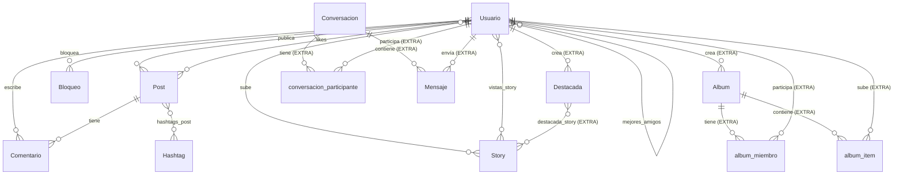

# Modelo de datos

Base de datos PostgreSQL. El script completo está en [`backend/src/db/tables.sql`](../backend/src/db/tables.sql).

Los nombres de entidades, relaciones y columnas siguen la consigna (`instagram.md`). Lo que no está en la consigna está marcado como **EXTRA**; ninguna tabla extra contradice a la consigna.

## Diagrama



## Entidades de la consigna

| Tabla | HU | Descripción |
|---|---|---|
| `Usuario` | HU1 | Cuenta. `username` solo admite `[a-z0-9._]`. `es_privada` arranca en `false`. **EXTRA:** `password_hash` para el login. |
| `Post` | HU2 | Foto con descripción (máx. 2200). `fecha_publicacion` automática. |
| `Comentario` | HU5 | Máx. 300 caracteres, no puede ser vacío. |
| `Story` | HU7 | `fecha_vencimiento` = publicación + 24 h, calculada por la base. Las vencidas **no se borran**: se filtran en las consultas y quedan en el archivo del dueño. |
| `Hashtag` | HU2, HU11 | `nombre` único y en minúsculas. |
| `Bloqueo` | HU10 | Un bloqueo por par (`UNIQUE`), no se puede bloquear a uno mismo. |

## Relaciones N a M de la consigna

| Tabla | HU | Clave | Notas |
|---|---|---|---|
| `seguidores` | HU3, HU4 | (`seguidor_id`, `seguido_id`) | `estado` ∈ `pendiente`, `aceptado`. No se puede seguir a uno mismo. |
| `likes` | HU5 | (`usuario_id`, `post_id`) | Un like por usuario por post. |
| `hashtags_post` | HU2, HU11 | (`post_id`, `hashtag_id`) | |
| `vistas_story` | HU9 | (`usuario_id`, `story_id`) | Una vista por usuario por story. |
| `mejores_amigos` | HU8 | (`usuario_id`, `amigo_id`) | |

## EXTRA: destacadas ordenables

| Tabla | Descripción |
|---|---|
| `Destacada` | Colección de stories del usuario. `orden` define su posición en el perfil. `portada_url` en `NULL` usa la primera story visible. |
| `destacada_story` | Stories dentro de una destacada, con su propio `orden`. |

- **Mismo dueño garantizado por la base:** `destacada_story` repite `usuario_id` y usa FK compuestas contra `Destacada(id, usuario_id)` y `Story(id, usuario_id)`. No se puede destacar la story de otra persona.
- **Reordenar:** los `UNIQUE (… orden)` son `DEFERRABLE INITIALLY DEFERRED`, así que se puede reasignar todo el orden dentro de una transacción sin choques intermedios.
- **Destacar mantiene la story viva:** una destacada puede apuntar a una story vencida. La consulta de destacadas no filtra por `fecha_vencimiento`.
- **Story de mejores amigos:** destacarla no la hace pública. Solo la ven el dueño y los de su lista `mejores_amigos`. Para los demás esa story se omite, y si no queda ninguna visible la destacada se oculta. *(Regla del service.)*

## EXTRA: álbumes compartidos

| Tabla | Descripción |
|---|---|
| `Album` | Álbum con título, creador y portada (`NULL` = primer item). |
| `album_miembro` | Participantes. `rol` ∈ `admin`, `miembro`; `estado` ∈ `pendiente`, `aceptado` (invitación). |
| `album_item` | Fotos subidas al álbum por cualquier miembro aceptado. |

- `album_item` es independiente de `Post`: lo subido a un álbum no aparece en el perfil, el feed ni los hashtags.
- **Visibilidad:** lo ven los miembros `aceptado` y los seguidores `aceptado` de cualquier miembro `aceptado` (salvo bloqueo con el creador). Solo los miembros suben items.

Reglas del service:

- El creador entra como `admin` con estado `aceptado`.
- Solo los miembros `aceptado` suben items.
- Invitar crea una fila `pendiente`; el invitado acepta o rechaza. No se puede invitar a alguien con quien existe un `Bloqueo` en cualquier sentido.
- Borra un item su autor o un admin. Solo un admin quita miembros o borra el álbum.
- Si el último admin se va, el rol pasa al miembro más antiguo.

## EXTRA: Reels

Un reel es un `Post` con `tipo = 'reel'` y `url_video` obligatorio (`url_imagen` es la portada). Así comparte likes, comentarios, hashtags, feed y estadísticas sin tablas duplicadas. La base garantiza `tipo = 'reel'` ⇔ `url_video IS NOT NULL`.

`Usuario.reels_desactivados = true` saca los reels del feed y del explorar de ese usuario.

## EXTRA: DMs

| Tabla | Descripción |
|---|---|
| `Conversacion` | 1 a 1 o grupal (`es_grupal`, `nombre`). |
| `conversacion_participante` | `estado` ∈ `solicitud`, `aceptada`; `ultima_lectura` para contar no leídos. |
| `Mensaje` | `texto` y/o `post_id` (post compartido; si se borra el post queda `NULL`). |

Reglas del service: una conversación 1 a 1 por par; si el destinatario no sigue al emisor entra como `solicitud`; con bloqueo no se puede escribir; compartir un post respeta su privacidad.

## EXTRA: cuentas, notificaciones y sesiones

| Tabla / columna | Descripción |
|---|---|
| `Usuario.eliminado_en` | Borrado lógico. Con valor, la cuenta no puede loguearse y desaparece de todas las consultas (perfil, posts, listas, contadores, likes, comentarios, búsqueda, notificaciones). |
| `Post.fecha_edicion`, `Comentario.fecha_edicion` | Última edición. |
| `Notificacion` | Destinatario, `actor`, `tipo` y referencia opcional a post / comentario / álbum; `leida`. |
| `refresh_token` | sha256 del token, `familia` (cadena de rotación), `expira_en`, `revocado_en`. |

## Reglas que no están en la base (van en los services)

| Regla | HU |
|---|---|
| Hashtags: detectar `#palabra` en la descripción y crear los que no existan. | HU2 |
| Cuenta pública → seguimiento `aceptado`; privada → `pendiente`. Al pasar a pública, las pendientes se aceptan. | HU3, HU4 |
| Permisos de ver, dar like y comentar (privacidad + bloqueos). | HU4, HU5, HU10 |
| Solo el autor del comentario o el dueño del post pueden borrarlo. | HU5 |
| Solo se agrega a mejores amigos a quien te sigue (`aceptado`); si deja de seguirte, sale de la lista. | HU8 |
| El dueño no cuenta como vista de su propia story. | HU9 |
| Bloquear elimina el seguimiento en ambos sentidos y la relación de mejores amigos. | HU10 |
| Tendencias: top 10 de las últimas 24 h, solo cuentas públicas. | HU11 |

## Crear la base

```bash
createdb instagram
psql instagram -f backend/src/db/tables.sql
```

Una base creada con una versión anterior del script se actualiza aplicando, en orden, los archivos de `backend/src/db/migrations/` que le falten.
